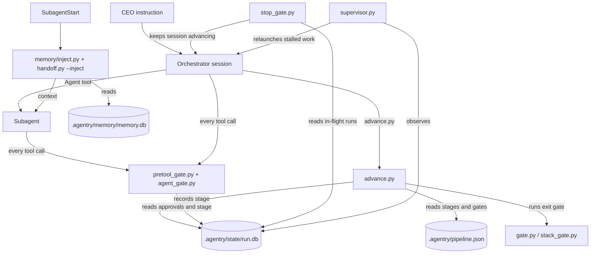

# Architecture

**Date:** 2026-10-13
**Author:** technical-writer (task-0052, swarm task-0118; task-0132)
**Status:** Draft
**Version:** 2.1

Agentry has no application layers (no controllers, services or models) and no
request cycle. Its architecture is the set of scripts that sit between the
CEO's instruction and the model's next tool call. This file describes the tree
as it is. Product context is in `project-context.md`; commands and versions are
in `stack.md`.

## Table of contents

- [Project structure](#project-structure)
- [Modules](#modules)
- [Data flow](#data-flow)
- [Dependency rules](#dependency-rules)
- [Where new code goes](#where-new-code-goes)
- [State and storage](#state-and-storage)
- [Conventions that bind every script](#conventions-that-bind-every-script)
- [Cross-check against the memory store](#cross-check-against-the-memory-store)
- [Version history](#version-history)

## Project structure

```
src/                              # git repository root; commands run here
├── .claude/                      # the harness (what Agentry ships)
│   ├── CLAUDE.md                 # orchestrator doc and team roster
│   ├── settings.json             # hook wiring, statusLine, claudeMdExcludes
│   ├── agents/                   # 31 agent definitions (profile: dev, docs, readonly)
│   ├── rules/                    # policy the hooks enforce
│   ├── skills/                   # procedures agents invoke
│   └── tools/                    # all executable code, stdlib only
│       ├── payload.py            # measures what a dispatch costs
│       ├── pipeline/             # stage machine, gates, run state, supervisor
│       ├── hooks/                # session, rule-injection and notice hooks
│       ├── memory/               # memory store CLI, injection, sync
│       ├── setup/                # onboarding, fleet and repo-scan scripts
│       └── tests/                # unittest suite (one test_*.py per concern)
├── .agentry/                     # the project's own work product
│   ├── pipeline.json             # declarative stage machine and gate config
│   ├── project/                  # this overlay
│   ├── tasks/                    # backlog/, active/, done/, handoffs/, epics/, swarm/
│   ├── specs/  plans/            # approved specs and per-task plans
│   ├── memory/                   # memory.db (gitignored)
│   └── state/                    # run.db and lane files (gitignored, never edited by agents)
├── docs/                         # memory notes and technical documents
├── pyproject.toml                # ruff configuration
└── README.md
```

The Agentry workspace holds a second copy of `.claude/` and `.agentry/` one
level up, with `"cwd": "src"` in its `pipeline.json` and `repos.agentry.path`
set to `src`. The code lives in `src/`; the workspace copy is the harness the
orchestrator session itself runs.

### Worktree layout (when `worktrees.enabled`)

```
E:/Personal/Agenty/              # workspace root (not a git repo); live .claude/ and .agentry/
├── src/                         # trunk checkout: stays on main, never edited, the solo merge runs here
├── src-wt/                      # <repo path>-wt: one linked worktree per in-flight task
│   ├── task-0130/               # branch feature/task-0130, its own tmp/, gates run here
│   └── task-0131/
└── .agentry/state/run.db        # run row per task; the `worktree` column holds "src-wt/task-0130"
```

Pipeline state stays at the workspace root, so a tree carries code only. Hooks run
the live scripts at the root; the `.claude/tools` and `pipeline.json` copies inside
a tree are inert for hooks and are what the exit gates test. Swarm umbrellas and
runs registered before the flag keep working in `src/` and are exclusive. Codegraph
indexes the trunk only (`.codegraph/` at the root), so a tree's unmerged symbols
are not in the graph.

## Modules

All code is under `.claude/tools/`. Each script is standard-library Python and
runs as its own process (a hook or a CLI). There are no packages and no
`__init__.py` outside `tests/`, so scripts import their siblings by extending
`sys.path`.

### pipeline/ (stage machine)

| Module | Responsibility |
|---|---|
| `state.py` | Run state in SQLite, lane resolution (`PIPELINE_LANE`), paths to the task folders, `is_paused` and `is_parked`. Every other pipeline script reads and writes through it |
| `advance.py` | Registers a task and advances it one stage by running the stage's exit gate |
| `gate.py` | Runs an exit-gate command and logs the result |
| `stack_gate.py` | Runs the per-repo stage commands declared in `repos{}` |
| `artifact_gate.py` | Checks that a plan, brief or spec file exists, names the task and is long enough |
| `ui_evidence.py` | Checks for real-browser evidence on UI-touching tasks |
| `approvals.py` | Approval levels (`manual`, `assisted`, `auto`) and the checkpoints never granted |
| `approve.py` | Records a checkpoint approval, pause, resume or reject. Orchestrator only |
| `pretool_gate.py` | PreToolUse hook: commit, push, merge, branch, plan and review-stage rules; main-thread write scope |
| `agent_gate.py` | PreToolUse hook inside subagents: the `dev`, `docs` and `readonly` profiles |
| `stop_gate.py` | Stop hook: keeps a session advancing in-flight work, reports owed handoff and memory debt |
| `git_state.py` | Repo discovery from `repos{}` (a linked worktree, whose `.git` is a file, is never taken for a repo), merge detection, per-task branch reports, `work_trees_for_task` (where to read a task's changes) and `behind_trunk` (commits the trunk has that a ref lacks) |
| `worktree.py` | Single owner of worktree facts: config (`enabled`, `max_parallel`), `add` and `remove` (the only functions that run git), `status` (OK, LEGACY, MISSING, INVALID), `work_dir`, `owner_of`, `is_trunk_checkout`, slot counting, the dispatch line, orphan report; CLI `--list`, `--sweep`, `--remove`, `--repair`. Read-only functions are subprocess-free so hooks can call them |
| `handoff.py` | Validates, injects and indexes the handoff docs |
| `diff_checkpoint.py` | Builds the diff preview shown at the commit checkpoint |
| `mode.py`, `swarm.py`, `busy.py` | Session mode, the swarm dial, the busy marker |
| `supervisor.py` | Detached daemon: classifies runs healthy, stalled, looping, dead or hung, and relaunches only stalled or dead work |

### hooks/

| Module | Responsibility |
|---|---|
| `session_start.py` | SessionStart wiring |
| `main_thread_rules.py`, `inject_rules.py` | Deliver rule files to the main thread and to agents |
| `subagent_stop.py` | Reminds the orchestrator to record lessons when a subagent ends |
| `status_line.py` | Prints the one-line pipeline status (read-only access to `run.db`) |
| `refusal_notice.py` | Turns an `advance.py` refusal into a message the human sees |
| `dangerous_patterns.py` | Shared command patterns used by the gates |

### memory/

| Module | Responsibility |
|---|---|
| `memory.py` | CLI over `.agentry/memory/memory.db`: `--record`, `--query`, `--export`, `--stats` |
| `inject.py` | SubagentStart hook: queries the store with the active task's text and injects ranked rows |
| `update.py` | Post-task review gate: distilled rows must exist before the next task registers |
| `codebase_sync.py` | Detects module-map drift against git heads |

### setup/

| Module | Responsibility |
|---|---|
| `repo_scan.py` | Finds the repos under a root and writes `repos` and `lanes` into `pipeline.json` |
| `apply_optimization.py`, `rebuild_pipeline.py`, `substitute_tokens.py` | Onboarding: wire settings, rebuild stage commands, fill tokens |
| `fleet_rollout.py`, `finalize_fleet.py` | Roll the harness out across projects |

### payload.py

Measures the size of a dispatch (rules, agent definition, injected context) so
the token budget can be checked against numbers.

## Data flow



The model proposes a transition; only `advance.py`, `approve.py` and the other
scripts that write `run.db` record one. The hooks read the same store, so a
denial does not depend on what the model remembers.

## Dependency rules

- `state.py` is the base layer. It imports only the standard library. The rest of
  `pipeline/` imports it, and `mode.py`, `approvals.py` and `swarm.py` take
  their lane suffix from `state.LANE_SUFFIX` instead of re-reading the
  environment.
- Gates (`pretool_gate.py`, `agent_gate.py`, `stop_gate.py`) read state and
  config. They do not call `advance.py`.
- `worktree.py` imports `state` and `git_state` only. `git_state` imports
  `worktree` lazily inside the functions that need it, so there is no cycle;
  `gate.py`, `advance.py` and the gates import `worktree`, never the reverse. A
  read-only `worktree` function never starts a subprocess (hook budget).
- `pretool_gate.normalize` is the one path normaliser; `agent_gate` re-exports
  it rather than keeping a copy.
- Nothing in `.claude/tools/` imports a third-party package. `ruff` is a
  development tool, not a dependency.
- Tests import the module under test; no module imports from `tests/`.

## Where new code goes

| Type | Location |
|---|---|
| New stage logic or gate | `.claude/tools/pipeline/` |
| New hook script | `.claude/tools/hooks/`, then wire it in `.claude/settings.json` |
| New memory behaviour | `.claude/tools/memory/` |
| Onboarding or rollout script | `.claude/tools/setup/` |
| Test | `.claude/tools/tests/test_<concern>.py` (use `tmproot.sandbox()`, not `tempfile`) |
| Stage or gate configuration | `.agentry/pipeline.json`, orchestrator only |
| New policy | `.claude/rules/`, then list it in `claudeMdExcludes` if it is not core |
| Project-specific fact | `.agentry/project/` |

Check sibling files first and match their naming. Do not add a new top-level
folder under `.claude/tools/` without CEO approval.

## State and storage

| Path | Contents | Committed |
|---|---|---|
| `.agentry/state/run.db` (`run.<lane>.db` per lane) | One row per run (current state only) | No |
| `.agentry/state/events.db` (one per workspace) | The append-only event journal: transitions, gate runs, approvals, rejections, merges (history; only `supervisor.progress_at` reads it, and only to veto a relaunch; no gate reads it) | No |
| `.agentry/memory/memory.db` | `lesson`, `pattern` and `module` rows with an FTS5 index | No |
| `.agentry/tasks/` | Task files; the folder is the state | Yes |
| `.agentry/pipeline.json` | Stage machine, gates, repos, lanes, supervisor limits, `worktrees` block | Yes |
| `<repo path>-wt/<task>` (for example `src-wt/task-0130`) | A task's linked git worktree, created at registration and removed after the merge is confirmed; the relative path is the run row's `worktree` column (written only by `create_run`) | No (outside every repo) |

Task state is the folder a task file sits in (`backlog/`, `active/`, `done/`),
not a field. Agents never write under `.agentry/state/` or to `pipeline.json`;
the orchestrator applies configuration changes.

## Conventions that bind every script

- Hooks fail open. A bug in a gate allows the action instead of bricking the
  session. `pyproject.toml` leaves broad `except` and `pass` unlinted for this
  reason.
- Exit code 2 means "deny" for PreToolUse and "do not stop" for Stop. A
  script that can exit 2 by accident must not.
- Config is read at call time from `pipeline.json`; a missing or unreadable key
  falls back to a documented default.
- No Unix output redirects to `/dev/null` and none to `NUL` in any command a
  script builds or an agent runs (see `rules/quality-standard.md`).

## Cross-check against the memory store

The module rows in `.agentry/memory/memory.db` were recorded from the real
tree and can be compared with this layout through
`python .claude/tools/memory/memory.py --query "module"` (exit status 0 on
2026-10-12). The module list above was taken from a directory listing of
.claude/tools/ on 2026-10-09 and the responsibilities from each script's
docstring and the swarm board. Any module present in one and missing from
the other is a defect in this file.

## Version history

| Version | Date | Change |
|---|---|---|
| 2.1 | 2026-10-13 | Added `worktree.py`, the worktree layout, the import rule and the `worktree` run column (task-0132, epic-0004). |
| 2.0 | 2026-10-09 | Replaced the onboarding template (Laravel-style layers, module and database sections) with the real Agentry module layout (task-0052). |
