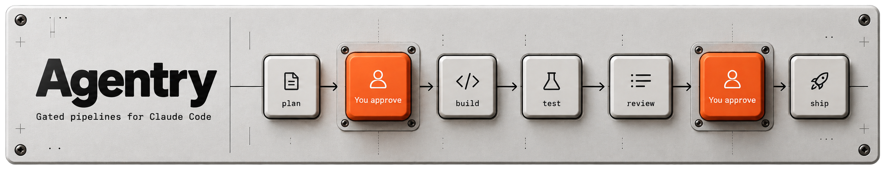
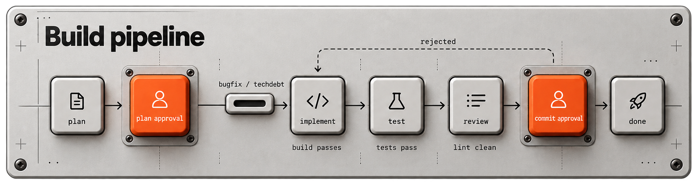
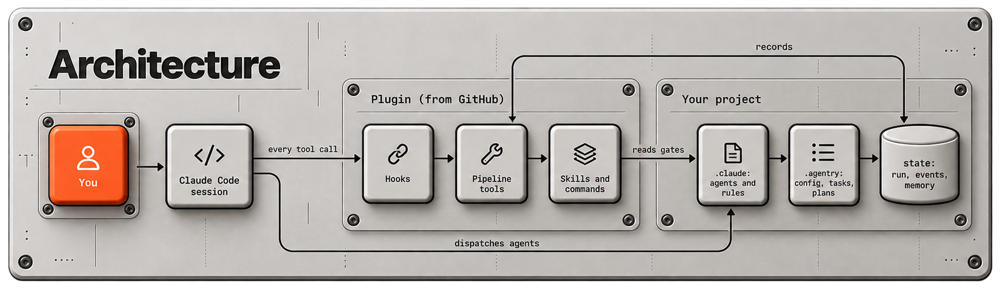

<p align="center">
  
</p>

<p align="center">
  
  
  
</p>

**Agentry makes Claude Code finish work the way a careful team would.** Each task walks through fixed stages, and a stage counts as done only when your real build, test or lint command exits clean. Claude proposes the next step. Python hooks decide whether it happens.

## Why it exists

Long agent runs fail in three predictable ways.

| What goes wrong | What Agentry does |
|---|---|
| The agent drifts away from the plan | You approve the plan before any code is written, and hooks deny edits until you do |
| The agent says "done" and it is not | A stage advances only when its exit command passes, and a script records the result |
| Context is lost between tasks | The next task cannot start until the previous one has a written handoff note |

## What you get

- **Gated stages.** `plan`, `implement`, `test`, `review`, `ready`, `done`, where `implement`, `test` and `review` each end on a command you configure.
- **31 role agents.** Architect, backend, frontend, QA, reviewer, security, writer and more. Each has a profile that limits what it may touch.
- **Folder-as-state tasks.** A task is in `backlog/`, `active/` or `done/`. There is no status field to fall out of sync.
- **Three dials you control.** Mode (build, plan, talk), approval level (manual, assisted, auto) and swarm (on, off), each set with one slash command.
- **Memory between tasks.** Handoff notes and a searchable lesson store are injected into every agent dispatch.

## Quick start

You need Claude Code, Python 3.12 or newer and git. Run from your project root:

```bash
claude plugin marketplace add AlexWaha/agentry --scope local
claude plugin install agentry@agentry --scope local
claude plugin list
```

`claude plugin list` should show `agentry@agentry` with scope `local` and status `enabled`. Restart Claude Code so the hooks load. No authentication is needed. Without a GitHub SSH key, set `CLAUDE_CODE_PLUGIN_PREFER_HTTPS=1` before the first command. Tested on Claude Code 2.1.299.

The plugin carries the tools, skills and hooks. Agents, rules and the pipeline config live in your project, and a one-time onboarding sets them up:

1. Copy `.claude/`, `.agentry/` and `CLAUDE.md` from a clone of this repository into your project.
2. Open Claude Code at the project root and paste the prompt from `.claude/_init-prompt.md`.
3. Answer its questions. It detects your stack and asks which commands gate each stage.

Step by step, with a first task end to end: [Getting started](docs/getting-started.md).

## How a task flows

<p align="center"><a href="docs/assets/build-pipeline.png"></a></p>

Orange stages are yours. At `plan-approval` you read the plan. At `ready` you read the diff with `/diff` and approve the commit, unless the approval level is `assisted` or `auto`, which skip that prompt (`auto` also skips the take step; a push is never automatic). A failed gate sends the task back to the same stage, up to three times, then parks it as blocked and tells you. `bugfix` and `techdebt` tasks skip the plan and start at `implement`. `done` is reached only when git confirms the branch is merged. The plan pipeline, which turns an idea into a spec and a task backlog, is in [Pipeline and approvals](docs/pipeline.md).

## Commands you will use

| Command | What it does |
|---|---|
| `/pipeline-show` | Print the current mode, approval level and swarm setting |
| `/pipeline-plan` | Switch to plan mode: brief, plan, spec and task files, no product code |
| `/pipeline-build-manual` | Build mode, you approve every checkpoint including the commit, swarm off |
| `/pipeline-build-assisted` | Build mode, commits pass without asking, swarm off |
| `/pipeline-talk` | Talk mode: discuss and prototype, nothing is tracked |
| `/pipeline-swarm-on` | Run each epic as a parallel agent swarm |
| `new-task` skill | Ask Claude to file a task into the backlog |

The plugin ships 43 skills, 16 of them the `/pipeline-*` commands. Full list with examples: [Commands](docs/commands.md).

## Architecture

<p align="center"><a href="docs/assets/architecture.png"></a></p>

The plugin is installed once and updated on its own schedule. Everything project-specific stays in your repository. Layout and mechanics: [design notes](docs/technical/design-notes.md).

## Documentation

| Page | Read it for |
|---|---|
| [Getting started](docs/getting-started.md) | Install, onboard a project, run a first task |
| [Commands](docs/commands.md) | Every slash command and skill |
| [Dashboard](docs/dashboard.md) | Start the read-only local dashboard, how it stays safe, stop and troubleshooting |
| [Pipeline and approvals](docs/pipeline.md) | Stages, checkpoints, modes, approval levels, swarm, worktrees |
| [Agents](docs/agents.md) | The roster, when each agent runs, what each may touch |
| [Configuration](docs/configuration.md) | The `pipeline.json` keys worth changing |
| [Extending Agentry](docs/extending.md) | Add an agent, a rule or a skill, and run beside other plugins |
| [Upgrade, pin and roll back](docs/upgrade.md) | Version control for the plugin |
| [Troubleshooting](docs/troubleshooting.md) | Hook denies in plain words, Windows notes |
| [Design notes](docs/technical/design-notes.md) | How enforcement works and where it stops |

## Status and contributing

Current release: 0.2.0. See [CHANGELOG.md](CHANGELOG.md) and the Releases page. Found a bug or a gap in the docs? Open an issue on GitHub.

## License

MIT. See [LICENSE](LICENSE).

---

<p align="center">
  
</p>
