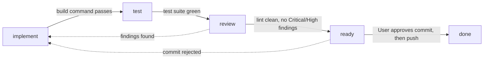
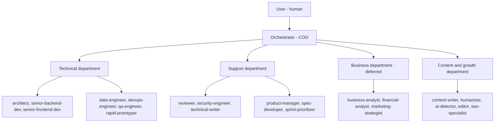

# Agentry

*"It's a tool dude"*

Agentry is a deterministic orchestration harness for Claude Code. A team of 31
role agents (architect, backend, frontend, QA, reviewer, security, writer, and
more) is driven through a gated finite state machine whose transitions are
recorded by Python hooks and SQLite, not decided by the model.


## Table of contents

- [What it is](#what-it-is)
- [How it works](#how-it-works)
- [Requirements](#requirements)
- [Install and first run](#install-and-first-run)
  - [Install](#install)
  - [Pin a version per project](#pin-a-version-per-project)
  - [Upgrade](#upgrade)
  - [Roll back](#roll-back)
  - [Releasing (maintainers)](#releasing-maintainers)
  - [Onboard the project](#onboard-the-project)
- [Usage](#usage)
- [The agent roster](#the-agent-roster)
- [Configuration](#configuration)
- [Roadmap](#roadmap)
- [License](#license)

## What it is

Autonomous agent runs share three failure modes: they drift from the plan
over a long session, they self-certify work as done based on their own
say-so, and they lose context between one task and the next. Agentry is a
set of Claude Code agents, rules, and Python hooks built to stop those three
things specifically:

- **Deterministic gates.** A task moves from one pipeline stage to the next
  only when `tools/pipeline/advance.py` runs the stage's real exit command
  (build, test, lint) and reads a real exit code. The model proposes that a
  stage is done; only the script records the transition, in
  `.agentry/state/run.db`.
- **Folder-as-state task tracking.** A task's status is the directory its
  file sits in - `.agentry/tasks/backlog/`, `active/`, or `done/`. There is no
  `status:` field to drift out of sync with reality.
- **Forced context handoff.** Before a new task can start, the previous
  completed task must have a handoff document in `.agentry/tasks/handoffs/`,
  written by the next task's own assignee, who is instructed to write it in its
  own words from the merged diff and the gate log. `advance.py` and the `Stop`
  hook both refuse to proceed without a valid doc, but validation checks
  structure only (six headings, minimum lengths, no scaffold marker), not
  authorship: a pasted task description that meets those checks passes.

The Claude Code `PreToolUse`, `Stop`, `SubagentStart`, and `SubagentStop`
hooks wire this into every session: they deny writes outside an agent's
declared scope, block `git commit` and `git push` until a human has recorded
approval, and keep the orchestrator moving through the backlog without
asking "should I continue?" at every step.

## How it works

### The build pipeline

Every implementation task travels the same five stages. Each arrow is a real
exit-gate command, not an agent's opinion.



There is no separate visual-diff stage. There used to be one, backed by a local
browser UI, and it was removed once Claude Code shipped a built-in `/diff`: the
User now reads the diff at the commit checkpoint, where the approval already
waits. Rejecting there sends the task back to `implement`.

`implement`, `test`, and `review` are editing stages: only one task occupies
one at a time, so there is never a concurrent edit to the working tree (a
multi-subtask epic registered as one umbrella task is the exception: see "Swarm
mode" in `.claude/rules/orchestration.md` and the swarm protocol in
`$AGENTRY_ROOT/skills/swarm/SKILL.md`). `done`
is reached only when git confirms the branch is actually merged into the main
branch, not merely pushed.

### Department structure



The orchestrator never writes code or documents outside `.claude/`,
`.agentry/`, `docs/`, any `README*` file at any depth, and the root `CLAUDE.md`. That is enforced by the
`orchestrator_gate` block in `pipeline.json`, checked on every tool call by
`pretool_gate.py` - dispatching the owning agent is the only path to a code
change.

## Requirements

- **Claude Code**, with hooks and subagent dispatch (`SessionStart`,
  `PreToolUse`, `Stop`, `SubagentStart`, `SubagentStop`, `PreCompact`,
  `PostToolUse` are all wired in the plugin's `hooks.json`).
- **Python 3.12 or newer** on PATH. The scripts themselves parse on 3.9, but
  the project targets current stable releases and is only tested there. Every
  script under `plugin/tools/` is standard-library only (`json`, `sqlite3`,
  `subprocess`, `re`, `time`) at runtime, so no `pip install` step exists or is
  needed to run the harness.
- **git**, for branch checks, merge detection, and the commit/push
  checkpoints.
- **ruff** (development dependency only, not needed at runtime): lints
  `plugin/tools` as the `review` stage's exit gate. Config lives in the root
  `pyproject.toml`. Install with `pip install ruff` or any package manager;
  the harness itself never imports it.
- **codegraph MCP server** (optional). Wired per project in the root
  `.mcp.json` (`codegraph serve --mcp`). It indexes code into `.codegraph/`
  at the project root for fast structural queries; the harness runs without
  it, falling back to `Grep`/`Glob`.

## Install and first run

Agentry is a Claude Code plugin, installed from the public GitHub repository.
The plugin carries the tools, skills and hooks (`plugin/`, 42 skills and 46 hooks
on seven events). The agents, rules and `.agentry/` overlay stay in your
project and are set up by the onboarding prompt below. Layout of the plugin
tree: [plugin-layout.md](docs/technical/plugin-layout.md).

### Install

Run from the project root. `--scope local` limits the install to this project;
without it Claude Code declares the marketplace at user scope and writes it
into `~/.claude/settings.json`.

```bash
claude plugin marketplace add AlexWaha/agentry --scope local
claude plugin install agentry@agentry --scope local
claude plugin list
```

`claude plugin list` should show `agentry@agentry`, scope `local`, status
`enabled`. Restart Claude Code: `hooks.json` is read at session start. The
plugin's `SessionStart` hook then exports `AGENTRY_ROOT` (the cached plugin
copy) and `CLAUDE_PROJECT_DIR` into every Bash call. The install needs no
authentication; the clone is anonymous HTTPS.

Status: measured on Claude Code 2.1.299 with HTTPS forced
(`CLAUDE_CODE_PLUGIN_PREFER_HTTPS=1`). If you have no SSH key for GitHub, set
that variable before the `marketplace add` command.

Releases are tagged `vX.Y.Z` and follow semantic versioning. The changelog is
[CHANGELOG.md](CHANGELOG.md).

### Pin a version per project

A github-source install copies the plugin into
`~/.claude/plugins/cache/agentry/agentry/<version>` and the session runs from
that copy. A release is a version bump in `plugin.json`, a changelog entry and
a `vX.Y.Z` tag.

Status: a local-scope install is recorded per project, so it should stay on the
installed version until you run `claude plugin update`, and pushing to `main`
should change nothing for it. Not yet measured across a real version bump.

Check what a project runs with `claude plugin list` (the `Version:` line).

To pin a project to a release, put the tag or branch after `#` when you add the
marketplace:

```bash
claude plugin marketplace add AlexWaha/agentry#v0.2.0 --scope local
claude plugin install agentry@agentry --scope local
```

Claude Code passes the ref to `git clone --branch`, so a tag or a branch works
and a commit SHA does not ("Remote branch <sha> not found"). The ref is stored
in the marketplace entry (`"ref": "v0.2.0"`). A version suffix such as
`agentry@agentry@0.2.0` is silently ignored, so do not use it.

Running `marketplace add` again for the existing `agentry` marketplace prints
"already on disk" and changes nothing (no re-clone, the ref stays). To move a
tag-pinned project to another tag, remove and re-add the marketplace, as in
"Roll back" below.

Status: measured with `#main` on Claude Code 2.1.299. The tag form is pending
the first tag.

### Upgrade

```bash
claude plugin marketplace update agentry
claude plugin update agentry@agentry --scope local
```

Then restart Claude Code. Read the [changelog](CHANGELOG.md) first and run the
commands from the project root, so the update applies to that project.

Status: on 2.1.299, `marketplace update` keeps the ref pin, and `plugin update`
at the same version prints "already at the latest version". An upgrade across a
real version bump from GitHub is not yet measured. A project pinned to a tag
does not move on update; to change tags, remove and re-add as in "Roll back".

### Roll back

If an upgrade breaks a gate, remove the plugin and the marketplace from the
project, then add the marketplace again pinned to the previous release:

```bash
claude plugin uninstall agentry@agentry --scope local
claude plugin marketplace remove agentry --scope local
claude plugin marketplace add AlexWaha/agentry#v<previous> --scope local
claude plugin install agentry@agentry --scope local
```

Restart Claude Code. Release tags (`v0.2.0` and later) are listed under the
repository's Releases page, each with its notes.

Warning: `marketplace remove` cascades. It uninstalls every plugin installed
from that marketplace, at every scope.

Status: all four commands exit 0, measured on 2.1.299 with a branch ref; the tag
form is pending the first tag.

### Releasing (maintainers)

`main` is protected, so a release starts on a task branch.

1. Bump `version` in `plugin/.claude-plugin/plugin.json` and add the
   `CHANGELOG.md` entry on the task branch.
2. Gated local merge into `main`.
3. Tag the merge commit `vX.Y.Z`.
4. Push `main` and push the tag. Each push needs its own recorded User
   approval.
5. Publish the GitHub release with the notes from `docs/release/`.
6. On each machine that runs the plugin: `claude plugin marketplace update
   agentry`, `claude plugin update agentry@agentry --scope local`, restart.

### Onboard the project

After the plugin is installed:

1. Copy `.claude/`, `.agentry/` and the root `CLAUDE.md` into your project
   (back up any existing `CLAUDE.md` first). The plugin ships the tools, skills
   and hooks only; the agents and rules come from this repository's `.claude/`,
   and the pipeline config, project overlay and task templates from its
   `.agentry/` (clone it or download it).
2. Open Claude Code at the project root.
3. Paste the prompt from `.claude/_init-prompt.md`. It runs two phases:
   Phase A auto-detects your stack (language, framework, test/format/build
   commands, database, CI) and fills `.agentry/project/stack.md` and the
   `{{PLACEHOLDER}}` tokens across `.claude/`; Phase B is an interactive
   interview that configures `.agentry/pipeline.json` (stages, exit-gate
   commands, retry budget, checkpoint automation) with you.
4. Follow `.claude/_onboarding.md` for anything Phase A/B did not cover:
   optional rules (`i18n`, `mobile`, `business-standards`), permissions in
   `settings.json`, and the codegraph `init`/`status` check.

**Read section 2 of `.claude/_onboarding.md` before you trust the gates.** This
repository is both the template and a live project, so its `pipeline.json` ships
with Agentry's own values rather than `{{PLACEHOLDER}}` tokens. Searching for
leftover `{{...}}` will therefore find nothing, while four keys still need your
values: `main_branch` and the exit-gate commands of `implement`, `test` and
`review`. Inherit them unchanged and your implement gate lints this harness
instead of building your code, which passes and proves nothing. Section 2 lists
each key with the value you inherit and the placeholder it replaced.

Hooks and skills address the plugin tree as `${CLAUDE_PLUGIN_ROOT}`; prose and
Bash use `$AGENTRY_ROOT`.

## Usage

### Modes and approval levels

`.agentry/state/mode` picks which pipeline a newly registered task follows:

| Mode | Pipeline |
|---|---|
| `build` | `implement -> test -> review -> ready -> done` |
| `plan` | `formalize -> draft -> plan-review -> approval -> breakdown -> done` |
| `talk` | no pipeline registration |

`.agentry/state/approvals` picks how many checkpoints pass without asking you:

| Level | Behavior |
|---|---|
| `manual` | every checkpoint waits for you: which task to take, the commit |
| `assisted` | committing passes unasked; you start each task, and the conveyor stops after it |
| `auto` | the above, plus taking the next ready task on its own once the current one is done |

`.agentry/state/swarm` is the third dial, `on` or `off` (default `off`): whether a
multi-subtask epic runs as a parallel agent swarm under one umbrella task. Set it
with `python "$AGENTRY_ROOT/tools/pipeline/swarm.py" on|off`; `python
"$AGENTRY_ROOT/tools/pipeline/mode.py" --show` prints all three dials, and the
`/pipeline-*` skills set them by name. The project values for the swarm protocol
are in `.claude/pipeline-adapter.md`.

The shipped `pipeline.json` lists `push` and `trunk_push` in
`approvals_never_granted`, so no level grants them. Subagent Write/Edit and
explicit-path shell writes to that file are denied; cd-relative and interpreter
writes are not yet covered (task-0116). `approvals.never_granted()` refuses the listed checkpoints before the level
and before any per-stage `auto_approve` entry is consulted (a missing or
unreadable list withholds both too), which is what keeps the push out of `auto`.
Without that listing, `auto` would also grant the push of the work branch. `manual`
grants nothing and `assisted` grants the commit only. No level grants the merge
into the main branch either: in `pr` mode
it happens in the web UI, by a human, and in `solo` mode the pipeline performs it
locally once the commit is approved. At `assisted` and `auto` the level itself
sets that commit approval, so in `solo` mode no human decides each merge there;
a supervisor-spawned (unattended) session is refused the merge regardless.

### The daily loop

```bash
# AGENTRY_ROOT is the plugin root; the plugin's session_start hook exports it.
# Check what is running
python "$AGENTRY_ROOT/tools/pipeline/state.py" --show

# Start a task (creates/records the run; branch must already be cut from up-to-date main)
python "$AGENTRY_ROOT/tools/pipeline/advance.py" --task task-0001 --type feature

# After the User reviews the diff and approves:
python "$AGENTRY_ROOT/tools/pipeline/approve.py" --task task-0001 --gate commit
git commit -m "..."
python "$AGENTRY_ROOT/tools/pipeline/advance.py" --task task-0001

python "$AGENTRY_ROOT/tools/pipeline/approve.py" --task task-0001 --gate push
git push
python "$AGENTRY_ROOT/tools/pipeline/advance.py" --task task-0001
```

Between the start of a task and its tail checkpoints (the commit, and - in `pr`
mode only - the push after it),
the orchestrator drives it without asking to continue: the `Stop` hook
(`stop_gate.py`) blocks the session from ending while any task is
advanceable or a ready backlog task remains, and reconciles a task's folder
against git and `run.db` state before it allows an idle stop. A `blocked`
task (gate failed past the retry budget) is surfaced to you; it is never
retried on its own.

New tasks are written into `.agentry/tasks/backlog/` (`skills/new-task`).
`advance.py` moves a task's file `backlog/ -> active/` when it registers,
and `active/ -> done/` only once `git_state.py` confirms the branch is
merged into the main branch.

## The agent roster

| Agent | Profile | Dispatch when |
|---|---|---|
| architect | readonly | planning a feature/system, DB schema, API contract decisions |
| senior-backend-dev | dev | backend feature, bugfix, refactor, migration |
| senior-frontend-dev | dev | web/mobile UI feature, component work |
| data-engineer | dev | data pipelines, ETL, warehouse schemas, data quality |
| devops-engineer | dev | containers, CI/CD, deploy, infrastructure |
| qa-engineer | dev | writing/running the test suite, quality gates |
| rapid-prototyper | dev | throwaway MVP/spike to validate an idea fast |
| reviewer | readonly | code/architecture review, before QA sign-off |
| security-engineer | readonly | security audit, threat model, vulnerability review |
| performance-benchmarker | readonly | load tests, performance baselines and regressions |
| accessibility-auditor | readonly | WCAG/a11y audit of UI work |
| evidence-collector | readonly | screenshots/log proof of UI behavior during review |
| incident-response-commander | readonly | production incident triage, post-mortems |
| technical-writer | docs | documentation, API docs, changelog after phases |
| ux-ui-designer | docs | wireframes, user flows, design review |
| ux-researcher | docs | user interviews, surveys, usability findings |
| spec-developer | docs | writing the spec from the architect's plan |
| product-manager | docs | epic + task decomposition from an approved spec |
| sprint-prioritizer | docs | ordering the backlog, status reporting |
| feedback-synthesizer | docs | consolidating user feedback into themes |
| business-analyst | docs | market research, business plan, requirements analysis (deferred) |
| financial-analyst | docs | financial models, unit economics, pricing, runway (deferred) |
| marketing-strategist | docs | GTM strategy, channels, launch planning (deferred) |
| brand-guardian | docs | brand consistency review of outward-facing assets (deferred) |
| content-manager | docs | content strategy, editorial calendar, briefs |
| content-writer | docs | drafting copy from briefs, runs before humanizer |
| humanizer | docs | de-AI-ifying prose, runs after content-writer |
| ai-detector | readonly | AI-slop verdict on prose, after humanizer, before reviewer |
| editor | docs | line/copy edit, factual integrity, terminology |
| seo-specialist | docs | technical + on-page SEO, keyword strategy |
| geo-specialist | docs | generative engine optimization (AI answer citations) |

`dev` agents can edit code but cannot approve their own checkpoints or run
the full test suite standalone. `readonly` agents can read and run
non-mutating commands but cannot Edit or Write. `docs` agents can write only
under `.claude/`, `.agentry/`, `docs/`, and any `README*` file at any depth. Every profile is
enforced inside the subagent itself via `agent_gate.py`. Each agent declares
its profile with a `profile:` key in its frontmatter, and the plugin's
`hooks.json` runs `agent_gate.py` as a `PreToolUse` hook for subagents by that
profile - not left to the prompt.

## Configuration

`.agentry/pipeline.json` declares the two pipelines (`build`, `plan`): their
stages, the owning agent per stage, allowed tools, the exit-gate command, the
retry budget, the continuation ceiling, the main branch name, and which
checkpoints (if any) are auto-approved. It also carries the `handoff` block
(baseline, whether an edit freeze applies while handoff debt exists) and the
`memory` block (baseline for the post-task memory-review gate).

`.agentry/project/` is the per-project overlay a new adopter fills in during
onboarding:

| File | Content |
|---|---|
| `project-context.md` | product, domain terminology, features, phase activation |
| `architecture.md` | module/folder layout, dependency rules |
| `api-conventions.md` | framework-specific controller/validator/resource patterns |
| `stack.md` | language, framework, test/format/lint/build commands, env vars, routes - the source of truth for every `{{PLACEHOLDER}}` token elsewhere in `.claude/` |

If `project/` is empty or still full of `[PROJECT-SPECIFIC - REPLACE ME]`
markers, the template has not been onboarded to that project yet.

## Roadmap

Sourced from `.agentry/plans/2026-09-12-harness-overhaul-plan.md`.

- Cut preloaded context per dispatched agent from roughly 145k tokens to
  under 40k (character-budgeted memory injection, tagged lessons, split
  rules).
- Fix the stop-gate continuation counter so any blocking branch is bounded,
  not only editing stages.
- Multi-repo lanes: a `repos{}` map in `pipeline.json`, per-repo gates, and
  backlog filtering so two lanes stop competing for the same queue.
- Human checkpoints routed through `AskUserQuestion` instead of plain chat
  text, plus visible hook output (terminal alert, status line).

## License

Released under the MIT License. See [LICENSE](LICENSE) for the full text.
