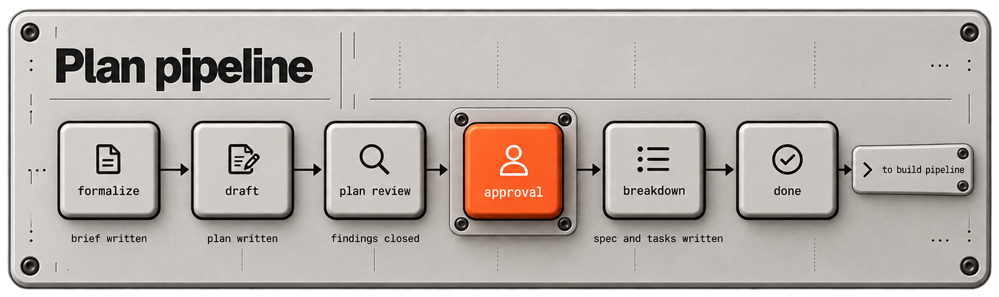
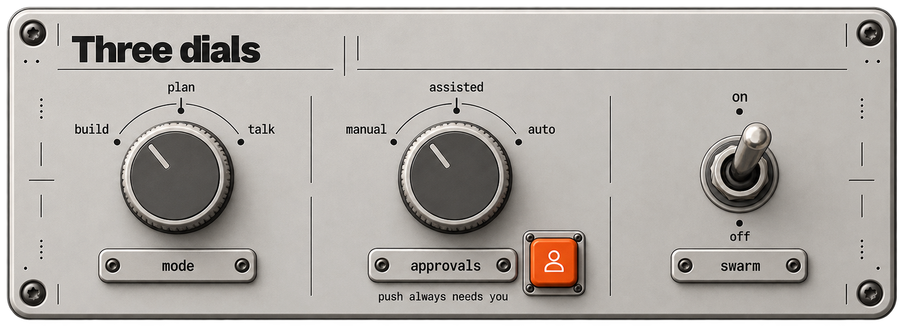

# Pipeline and approvals

This page explains what you see and what you decide while a task moves through Agentry.

## Table of contents

- [Two pipelines](#two-pipelines)
- [The build pipeline](#the-build-pipeline)
- [The plan pipeline](#the-plan-pipeline)
- [How a checkpoint works](#how-a-checkpoint-works)
- [The three dials](#the-three-dials)
- [Workflow mode: solo or pr](#workflow-mode-solo-or-pr)
- [Swarm](#swarm)
- [Worktrees](#worktrees)
- [Handoff and memory between tasks](#handoff-and-memory-between-tasks)
- [When something stops](#when-something-stops)

## Two pipelines

| Pipeline | Used for | Ends with |
|---|---|---|
| `build` | Shipping one task | Code merged into your main branch |
| `plan` | Turning an idea into work | An approved spec, an epic and task files in the backlog |

Both are driven by the same script, `advance.py`, and both advance a stage only when its gate passes. The pipeline never asks you a clarifying question halfway through. All questions are answered in plan mode, before any task is registered for build. Which pipeline a new task follows is set by the mode dial.

## The build pipeline

<p align="center"><a href="assets/build-pipeline.png"></a></p>

| Stage | Owner | The gate that must pass | You |
|---|---|---|---|
| `plan` | The task's developer agent | A plan file for this task exists in the plans folder and has real content | |
| `plan-approval` | You | Your recorded approval of the plan | Read the plan and approve or reject it |
| `implement` | Developer agent | Your build command exits 0 | |
| `test` | `qa-engineer` | Your test command exits 0 | |
| `review` | `reviewer`, plus `security-engineer` when relevant | Your lint command exits 0 and every Critical or High finding is closed. The stage is read-only | |
| `ready` | The orchestrator | All gates green, diff prepared | Read `/diff` and approve or reject the commit. Under `assisted` and `auto` this prompt is skipped |
| `done` | Pipeline in `solo` mode, you in `pr` mode | Git confirms the branch is merged | |

The task type decides the first stage. Every type except `bugfix` and `techdebt` starts at `plan`. Those two start at `implement`, with no plan step and no plan approval.

Which command each gate runs is yours to set during onboarding: see [Configuration](configuration.md).

## The plan pipeline

<p align="center"><a href="assets/plan-pipeline.png"></a></p>

| Stage | Owner | Output |
|---|---|---|
| `formalize` | `architect` | A brief: the problem, scope, non-goals and open questions. It waits for your answers |
| `draft` | `architect` | The plan |
| `plan-review` | `reviewer` | A read-only review. Critical and High findings must close before approval |
| `approval` | You | Your approval. One wrong assumption would be copied into every task below it, so this checkpoint is never automatic |
| `breakdown` | `product-manager` | A spec with testable acceptance criteria, then task files in the backlog |
| `done` | | |

A spec cannot be approved while it still lists open questions. Work that spans several tasks needs a spec and an epic. A single feature or bugfix can go straight from a plan to a task.

## How a checkpoint works

A checkpoint is the only place the pipeline stops for you. This is the commit checkpoint:

<p align="center"><a href="assets/commit-approval-sequence.jpg"></a></p>

Three rules sit behind that diagram:

- The model never writes a transition. Only the scripts do, after reading a real exit code.
- A hook denies `git commit` until the approval is recorded, and `git push` until its own approval is recorded. Asking nicely in chat is not enough, because the hook checks the record.
- You can reject at the commit checkpoint. The task returns to `implement` and your comments are attached to it.

## The three dials

<p align="center"><a href="assets/dials.png"></a></p>

**Mode** picks the flow.

| Mode | What runs |
|---|---|
| `build` | The build pipeline: `plan`, `plan-approval`, `implement`, `test`, `review`, `ready`, `done` |
| `plan` | The plan pipeline: `formalize`, `draft`, `plan-review`, `approval`, `breakdown`, `done`. No product code is written |
| `talk` | Nothing is registered. Claude answers, investigates and prototypes in scratch space. No task files, no branches, no product edits |

If you ask for an implementation while plan or talk mode is on, Claude says which mode is active and asks before switching.

**Approvals** pick how many checkpoints pass without asking you.

| Level | Take a task | Commit | Push |
|---|---|---|---|
| `manual` | You start each task | You approve | You approve |
| `assisted` | You start each task | Passes unasked | You approve |
| `auto` | Next ready task starts on its own | Passes unasked | You approve |

In plain terms: `assisted` skips the commit prompt, so you never see the `/diff` step. `auto` skips both the take step and the commit prompt. Use `manual` when you want to read every diff. A push is never automatic.

Two checkpoints are never granted by any level: the plan approval, and every push. The shipped configuration lists `push` and `trunk_push` as never granted, so even `auto` stops at a push. Moving a task to `done` and answering planning questions are never automatic either.

**Swarm** is `on` or `off`, default `off`. See [Swarm](#swarm).

## Workflow mode: solo or pr

The `workflow.mode` key in `pipeline.json` says how work reaches your main branch. It is a project setting you choose at onboarding, not a dial.

| Mode | For | After the commit approval |
|---|---|---|
| `pr` | A project with a second person who reviews and merges | You push the branch, with its own approval, and a human opens and merges the pull request |
| `solo` | One author with nobody to hand a pull request to | The pipeline merges locally. The merge still needs a task branch, a run record and an approved commit |

Working alone does not loosen the push rule. A push to the remote needs your explicit approval in chat in both modes. In `solo` mode, publishing the main branch is a one-shot approval that covers exactly one push.

## Swarm

With swarm on, an epic with two or more subtasks registers as one umbrella task. Several agents then work in parallel inside its `implement` stage, and QA runs once after all of them report done. With swarm off, tasks run one at a time. Switch with `/pipeline-swarm-on` and `/pipeline-swarm-off`. The protocol is the `swarm` skill.

## Worktrees

Worktrees are a project setting, not a dial. In `pipeline.json`:

```json
"worktrees": { "enabled": false, "max_parallel": 2 }
```

When `enabled` is true, each task gets its own git worktree next to your repository, its gates run there, and up to `max_parallel` tasks can be in an editing stage at once. When it is false, only one task edits at a time. Check the current state with `worktree.py --list`. Swarm umbrellas always stay in the main tree.

## Handoff and memory between tasks

Two debts must be paid before the next task starts:

1. **Handoff note.** The previous task needs a document with six named sections, written by the next task's assignee from the merged diff and the gate log.
2. **Memory review.** The finished task is distilled into lessons and patterns in the project memory, then stamped.

Both are enforced at registration and by the stop hook. The memory store is queried with the text of the active task and the best matches are added to every agent dispatch. For what the handoff check does and does not prove, see [design notes](technical/design-notes.md#handoff-validation).

## When something stops

| What you see | What it means | What to do |
|---|---|---|
| The task is parked at `plan-approval` or `ready` | It is waiting for you | Read the plan or the diff, then approve or reject |
| The task is `blocked` | A gate failed more times than the retry budget (3) | Read the failure, fix the cause or send guidance, then ask Claude to continue |
| A tool call is denied with a message | A hook enforced a rule | See [Troubleshooting](troubleshooting.md) |
| Claude keeps working and does not ask "what next" | The stop hook is driving in-flight work | This is intended. Use `/pipeline-talk` if you want a conversation instead |

To drop a task, tell Claude to abandon it. It closes the run, moves the file to `done/`, touches no git state and owes no handoff note.
