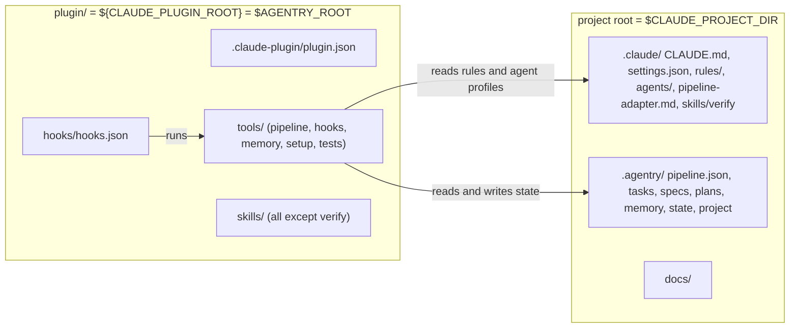

# Plugin layout and the two roots

**Date:** 2026-10-14
**Author:** technical-writer (task-0038, subtask S6)
**Status:** Draft
**Version:** 1.0

---

## Table of contents

- [Summary](#summary)
- [The layout](#the-layout)
- [The two roots](#the-two-roots)
- [How paths resolve](#how-paths-resolve)
- [What stays project-side and why](#what-stays-project-side-and-why)
- [The verify skill](#the-verify-skill)
- [Hook registration](#hook-registration)
- [Writing paths in documents](#writing-paths-in-documents)
- [The interim state until task-0039](#the-interim-state-until-task-0039)
- [Open items](#open-items)
- [Version history](#version-history)

---

## Summary

Agentry's code and skills sit in a Claude Code plugin tree, `plugin/`. Everything
a project owns (rules, agents, both `CLAUDE.md` files, `settings.json`,
`.agentry/`) stays in the project. Two directories, two variables:

| Root | Directory in this repository | Variable in hooks and skills | Variable in prose and Bash | Holds |
|---|---|---|---|---|
| Plugin root | `plugin/` | `${CLAUDE_PLUGIN_ROOT}` | `$AGENTRY_ROOT` | `tools/`, `skills/`, `hooks/hooks.json`, `.claude-plugin/plugin.json` |
| Project root | `src/` (the workspace has a copy one level up) | `$CLAUDE_PROJECT_DIR` | `$CLAUDE_PROJECT_DIR` | `.claude/` (rules, agents, `CLAUDE.md`, `settings.json`), `.agentry/`, `docs/` |

This document records the layout decided in the task-0038 plan
(`.agentry/plans/2026-10-09-task-0038-plugin-layout.md`, with its 2026-10-14
addendum) and the probe results that shaped it
([plugin-probes-2.1.299.md](plugin-probes-2.1.299.md)).

## The layout



The tree in this repository after the move:

```
src/
├── plugin/                       # plugin root
│   ├── .claude-plugin/plugin.json    # name "agentry", version 0.1.0
│   ├── hooks/                        # hooks.json, cleanup-nul.sh
│   ├── skills/                       # 43 skill directories and README.md, except verify
│   └── tools/                        # pipeline/, hooks/, memory/, setup/, tests/, payload.py
├── .claude/                      # project side
│   ├── CLAUDE.md  settings.json  pipeline-adapter.md
│   ├── rules/  agents/
│   ├── _onboarding.md  _init-prompt.md
│   └── skills/verify/
├── .agentry/                     # tracked templates; outside the plugin payload
└── docs/
```

`plugin/` contains nothing under `.agentry/`. The leak guard (task-0041) already
refuses a push that adds an `.agentry/` path the trunk lacks, and
`test_plugin_layout.py` asserts the same for the payload.

## The two roots

The plugin root is code: it can be replaced by an update, copied into a plugin
cache, or checked out beside the project. The project root is state and policy:
it is the user's, it is committed with the user's code, and no plugin update may
overwrite it. Keeping them apart is what lets one installed plugin serve many
projects.

Three rules follow from that split:

1. A script never derives the project root from its own location. It reads
   `CLAUDE_PROJECT_DIR`. Deriving it from `__file__` is correct only while the
   scripts sit at `<project>/.claude/tools`, which is true for the frozen
   workspace-root copy and false for a plugin cache.
2. A script may derive the plugin root from its own location (`plugin_root()` is
   script-relative). A worktree's `plugin/tools` therefore runs its own code,
   while the state it writes still goes to the live project root.
3. There is no fallback that walks up from the current directory looking for
   `.agentry/pipeline.json`. This repository tracks a template
   `.agentry/pipeline.json` in `src/` and in every `src-wt/<task>/` tree, so such
   a walk would resolve to the template and write state into the wrong tree. When
   `CLAUDE_PROJECT_DIR` is unset and the old layout does not apply, the script
   exits 2.

## How paths resolve

Probe P2 measured where each variable is visible on Claude Code 2.1.299.

| Where code runs | `CLAUDE_PROJECT_DIR` | `CLAUDE_PLUGIN_ROOT` | `AGENTRY_ROOT` |
|---|---|---|---|
| Plugin hook (any event) | set | set | absent in the PreToolUse hook measured in P2 (the env-file export reaches Bash, not other hooks), so a hook must not rely on it |
| `settings.json` hook | set | absent | absent |
| Main-thread Bash | absent unless exported | absent | present (exported) |
| Subagent Bash | absent unless exported | absent | present (exported) |
| `shell=True` child of a Bash call | absent unless exported | absent | present (exported) |
| Nested `claude -p` (supervisor) | inherited from the parent, possibly stale | absent | replaced by the child's own export |

The plugin's `session_start` hook writes `export AGENTRY_ROOT=...` and
`export CLAUDE_PROJECT_DIR=...` to `$CLAUDE_ENV_FILE`. Claude Code sources that
file into every later Bash call, which is why prose and commands can say
`$AGENTRY_ROOT`. Exporting `CLAUDE_PROJECT_DIR` as well matters: in a nested
`claude -p` the env-file export was the only thing that beat a stale inherited
value. The supervisor's `spawn_cmd` therefore sets `CLAUDE_PROJECT_DIR`
explicitly in the child environment instead of inheriting it. Only the plugin's
own `session_start` hook exports `AGENTRY_ROOT`.

Not yet measured: env-file behavior on `resume`, `compact` and `clear`. Task-0039
runs those checks when it installs the plugin.

Quoting. In a shell-form hook command, `${CLAUDE_PLUGIN_ROOT}` arrives with
forward slashes and works unquoted until the path holds a space (probe P4), so
every `hooks.json` command wraps it in double quotes. Prose commands follow the
same habit: `python "$AGENTRY_ROOT/tools/pipeline/state.py" --show`. Python code
that compares a plugin path goes through `pathlib.Path`, because exec-form hooks
receive backslashes on Windows.

Skills and gate commands.

| Context | Spelling |
|---|---|
| Skill body (`plugin/skills/**/SKILL.md`) | `${CLAUDE_PLUGIN_ROOT}/tools/...`. Claude Code substitutes it on invocation and on agent preload (probe P3), so no env file is needed |
| Rule, agent body, both `CLAUDE.md`, `pipeline-adapter.md`, overlay, docs, README | `"$AGENTRY_ROOT/tools/..."` |
| Hook command in `hooks.json` | `python "${CLAUDE_PLUGIN_ROOT}/tools/..."` |
| Gate command that tests code (`unittest`, `compileall`, `ruff`) | repository-relative `plugin/tools`, so a worktree tests its own code |
| Gate command that reads live plans (`artifact_gate`, `ui_evidence`) | `{root}/.claude/tools/...` through task-0038 (the frozen workspace-root copy), the `{plugin}` placeholder from task-0039 |

## What stays project-side and why

The plan first put agents in the plugin. Probe P0 re-measured on 2.1.299 and the
finding held: Claude Code ignores `permissionMode`, `hooks` and `mcpServers` on a
plugin agent and logs a warning for each. All 31 Agentry agents depend on all
three, so a plugin agent would silently lose its gate, its
`bypassPermissions` and its codegraph server. A plugin can only tighten
permissions, never grant them. Agents therefore stay in `.claude/agents/`.

| Item | Location | Reason |
|---|---|---|
| `agents/` | `.claude/agents/` | P0: `permissionMode`, `hooks`, `mcpServers` are ignored on plugin agents. The `hooks:` blocks themselves are replaced by plugin-level hooks (below), and each agent gains a `profile:` key that Claude Code accepts without a user-visible warning (P1) |
| `rules/` | `.claude/rules/` | Policy belongs to the project and is edited by it. `claudeMdExcludes` and the chunked injection hooks refer to these files by name |
| `CLAUDE.md` (root and `.claude/`) | project | A plugin cannot ship project instructions |
| `settings.json` | `.claude/` | P5: a plugin `settings.json` does not apply `env`, `permissions`, `hooks` or `claudeMdExcludes`, and the manifest validator reports `statusLine` as an unknown field. All of these stay in the project file |
| `pipeline-adapter.md` | `.claude/` | Project values for the swarm skill: the commands, roles and state directory of this project |
| `.agentry/` | project | Tasks, specs, plans, memory, run state and `pipeline.json` are the project's work product. The leak guard keeps them out of the payload |
| `skills/verify` | `.claude/skills/verify` | See the next section |
| `settings.local*.json` | project | Personal and gitignored; the example is seed material for the install guide, not payload |

The cost of this split: an adopting project needs a seeding step (rules, agents,
`CLAUDE.md`, `settings.json`, an `.agentry` skeleton) in addition to enabling the
plugin. That step belongs to task-0039 and task-0042, proposed as
`plugin/templates/`.

## The verify skill

Claude Code calls a skill named `verify` right before it commits. A plugin skill
is exposed as `agentry:verify`, and the pre-commit trigger may not fire for it.
Probe P3 could not settle this: the trigger fired nondeterministically in
headless mode (one or two runs per cell), for a plugin skill when its description
asked for it and for the project skill once without help. The safe reading, and
the plan's default (D4), is to keep `verify` at `.claude/skills/verify`. It holds
no checks of its own and delegates to `health-check`, which lives in the plugin:
the skill reads `$AGENTRY_ROOT/skills/health-check/SKILL.md`.

Other skill-name facts from P3: a unique plugin skill answers to both `/name` and
`/agentry:name`, so the prefix is not forced; and a project agent preloads a
plugin skill by its bare name, so the 18 agents that list skills need no edit.
Not measured: a bare name that exists in both the project and the plugin.

## Hook registration

Every hook registration moves from `settings.json` to `plugin/hooks/hooks.json`
(the plan counts 43 settings hooks plus two plugin-level entries, 45 in total).
The two new entries replace the `hooks:` blocks in agent frontmatter, which cannot
use `${CLAUDE_PLUGIN_ROOT}`:

- `agent_gate.py` as a PreToolUse hook, no `--profile` argument. It reads the
  profile from the `profile:` key of the dispatched agent's file, found through
  the `agent_type` field of the payload (present for every subagent call and
  absent on the main thread, P1). An agent it cannot resolve is treated as
  `readonly`.
- `dangerous_patterns.py` as a PostToolUse hook that runs for the `dev` profile
  only, as it does today.

Plugin-level hooks fire for built-in agents, project agents and plugin agents,
including in a folder that was never trusted interactively. Agent frontmatter
hooks do not: P0 measured that they are skipped in an untrusted folder. Moving the
gate into the plugin closes that gap.

One visible behavior change: a built-in or foreign agent with no roster file
(`general-purpose`, `Explore`) used to bypass `agent_gate` and now falls to
`readonly`. This tightening is decision D3 of the plan.

Chunked rule injection keeps today's counts: 16 `main_thread_rules.py` chunks plus
the `--index` entry at SessionStart and 14 `inject_rules.py` chunks at
SubagentStart. A rule that changes size can change a chunk count, and the parity
tests then fail until `hooks.json` is rewired.

## Writing paths in documents

| You are writing | Use |
|---|---|
| A command in a skill | `python "${CLAUDE_PLUGIN_ROOT}/tools/pipeline/state.py" --show` |
| A command in a rule, agent, `CLAUDE.md`, overlay, doc or README | `python "$AGENTRY_ROOT/tools/pipeline/state.py" --show` |
| A source-tree location in this repository | `plugin/tools/...`, `plugin/skills/...` |
| The state a command touches | `.agentry/...`, relative to the project root |

State once, in the document that needs it, that `AGENTRY_ROOT` is the plugin root
exported by `session_start`. `.claude/CLAUDE.md` and `rules/orchestration.md` do
this for the rule set.

## The interim state until task-0039

Task-0038 moves files and rewrites references but deploys nothing. The workspace
root keeps a frozen copy of the old layout, with `tools/` and `skills/` still
under `.claude/`, and the live session keeps running from it. Until task-0039
switches the live harness to a locally installed plugin:

- `AGENTRY_ROOT` is the workspace root `.claude`, so `"$AGENTRY_ROOT/tools/..."`
  resolves in the live workspace and in the plugin alike.
- The two gate commands that read live plans still use `{root}/.claude/tools/...`.
- The "Deploying a harness change from `src` to the live workspace" runbook in
  `rules/orchestration.md` stays unedited, because it is the live procedure until
  the switch replaces it.
- The harness is frozen between the task-0038 merge and the task-0039 switch: no
  harness-code task may merge in that window. An emergency fix is a hand patch to
  the root copy, recorded in the task notes.

After the switch, the deploy step is a plugin update plus a session restart.
Pointing the live session at `--plugin-dir src/plugin` is not part of the plan,
because it would load whatever sits in the working tree.

## Open items

| Item | Owner | Note |
|---|---|---|
| Marketplace install path, `enabledPlugins`, and the plugin cache copy of `CLAUDE_PLUGIN_ROOT` | task-0039 | Any file the plugin reads outside its own root breaks in a cached copy |
| `statusLine` as an optional snippet in the install guide | task-0042 | Cannot ship in the plugin (P5) |
| Env-file behavior on `resume`, `compact`, `clear`; bare-name collision of a plugin and a project skill | task-0039 | Not measured in S1 |
| `verify` trigger from a plugin skill | task-0039 | One interactive session with several commits |
| Fate of `tools/setup/` (`fleet_rollout`, `finalize_fleet`, `substitute_tokens`) | not assigned | Moved verbatim by task-0038 |

## Version history

| Version | Date | Author | Change |
|---|---|---|---|
| 1.0 | 2026-10-14 | technical-writer | First version, written with the task-0038 path rewrite |
